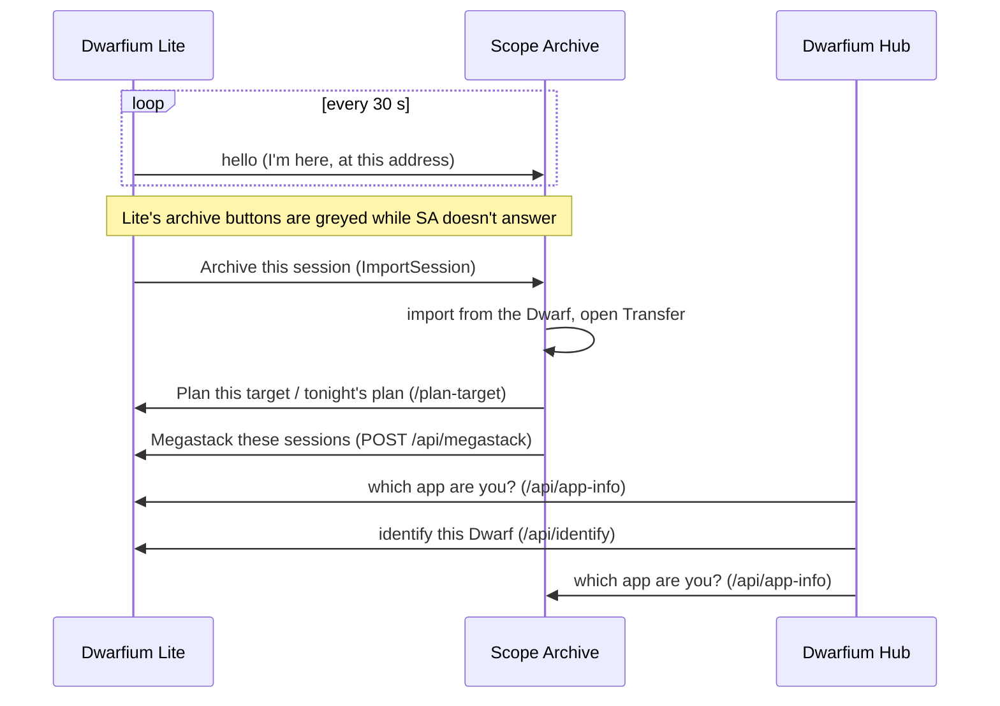

# How the apps work together

| From → to | What | Needs |
|---|---|---|
| Lite → Scope Archive | **Archive in Dwarfium Scope Archive**, links *Config · Sessions on the Dwarf · Backed-up sessions* | SA V3.4.0+, its URL and the *Dwarf Id* in Lite's Dwarf Settings |
| Scope Archive → Lite | **Plan a target**, tonight's plan | SA V3.4.2+, Lite running |
| Scope Archive → Lite | Megastack on the Dwarf | Lite connected to the Dwarf |
| Lite ↔ Scope Archive | Shared DSO catalog | SA installed next to Lite, or `DWARFIUM_ARCHIVE_DIR` |
| Hub → both | Install, start, watchdog, Dwarfs linking | — |
| Hub → Lite instances | State, Dwarfs, synchronization | An address and/or a shared folder |

When an app runs in its own window, the other app's pages open **in that window** (brought to front on Windows); otherwise in a browser tab.

## Lite's API (for other tools)

| Endpoint | Use |
|---|---|
| `GET /api/dwarfs` | Paired Dwarfs and their state |
| `GET /api/app-info` | `{"app", "name", "version"}` |
| `GET /api/identify?ip=` | Read a Dwarf's UID and model at an IP |
| `POST /api/schedule`, `/api/program` | Send targets (catalog page, Milky Way planner) |
| `GET /api/sites` | Sites |
| `POST /api/megastack` | Megastack on the Dwarf |
| `POST /api/open-page` | Show one of Lite's pages in its window |
