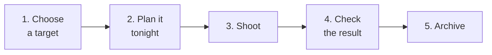

---
tags:
  - Lite
  - Scope Archive
  - Beginner
---

# Your first night, end to end

One complete cycle, with the simplest path at each step. Every step links to the how-to page with the other ways of doing it.

## 1. Choose a target

=== "With Scope Archive"

    **What to shoot tonight** (menu *Tonight's Targets*) lists the targets that are well placed tonight for your location, with a picture of each.

=== "With Dwarfium Lite only"

    In the program editor, **Pick from catalog**: ~880 objects (Messier, NGC, IC, Caldwell, bright stars), sorted by how high they get in the dark tonight.

More: [Choose and plan targets](../how-to/plan.md).

## 2. Plan it tonight

=== "From Scope Archive"

    Click the plan button of a target → Dwarfium Lite's **Plan a target** page opens with the target and its **best slot** tonight. Pick the Dwarf, the exposure, gain and filter, choose **program** and send.

=== "In Dwarfium Lite"

    In the Dwarf's **Programs** page, create a program: the target, **Calibration**, **Auto Focus**, the camera (exposure, gain, filter, count). The altitude chart shows the night; **Use best slot** fills the start and end times. **Save**.

A program waits in **ToDo** until its time. Make sure **Scheduler active** is on for this Dwarf: the scheduler starts it even with no page open — the app just has to be running.

More: [Capture and schedule](../how-to/capture.md).

## 3. Shoot

At the planned time, the program runs its steps: goto, calibration, focus, capture. Follow it on:

- the **dashboard card** (count captured / requested, stacked, live thumbnail);
- the **Dwarf's page** (live Tele / Wide view, step-by-step trace);
- the **Watch** page `/watch` — read-only, for a second screen or a friend.

!!! tip "Going to bed?"
    Set the [end of the night](../how-to/night.md): the Dwarf leaves its end-of-session screen, then closes its lenses or powers itself off once nothing else is planned.

## 4. Check the result

Next morning, the Programs page's **Results** tab: **View** on a finished run (**Check** on a failed one) shows images stacked / taken, integration time and the stacked thumbnail — read from what the Dwarf really saved.

More: [Check and explore results](../how-to/explore.md).

## 5. Archive it

From that same View dialog (or the Dwarf's **Astro Sessions** explorer): **Archive in Dwarfium Scope Archive**. Scope Archive imports that one session from the Dwarf and opens its **Transfer** page with it selected: pick the backup drive, start the copy.

More: [Back up and tidy sessions](../how-to/archive.md).

---

You've been through everything once. From here, use the [**I want to…**](../how-to/index.md) pages or the search box whenever you need something.
