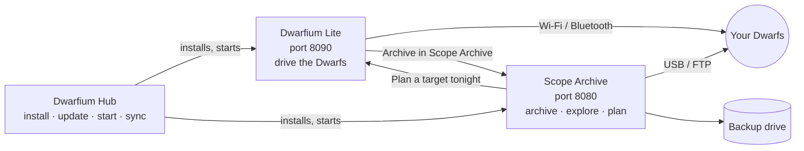

# Get started

New to the Dwarfium apps? These three pages take you from nothing to a first session backed up, in this order:

1. [**Install everything with the Hub**](install.md) — 10 minutes.
2. [**Add your first Dwarf**](first-dwarf.md) — a Site, then the Dwarf, by Bluetooth or without.
3. [**Your first night, end to end**](first-night.md) — choose a target, shoot it, check it, archive it.

## Which app do I need?

| You want to… | App |
|---|---|
| Drive one or several Dwarfs from a PC or a phone, run programs, schedule the night | **Dwarfium Lite** |
| Keep your sessions safe on a disk, find them again, score them, prepare them for Siril | **Dwarfium Scope Archive** |
| Know what to shoot tonight | **Scope Archive** (*What to shoot tonight*), then **Lite** to shoot it |
| Install / update both, start them together, keep a laptop or a mini PC in step | **Dwarfium Hub** |

You can use Lite alone or Scope Archive alone. Installed side by side (the Hub does it for you), they find each other and add buttons that jump from one to the other.

## What you need

- A **DWARF II, DWARF 3 or DWARF mini**, on your Wi-Fi network (or reachable by Bluetooth for the first pairing).
- A **Windows, macOS or Linux** computer. The apps are local web apps: once started, a phone or a tablet on the same network can use them too.
- For Scope Archive: a **backup drive** (an external disk or a folder) to copy your sessions to.
